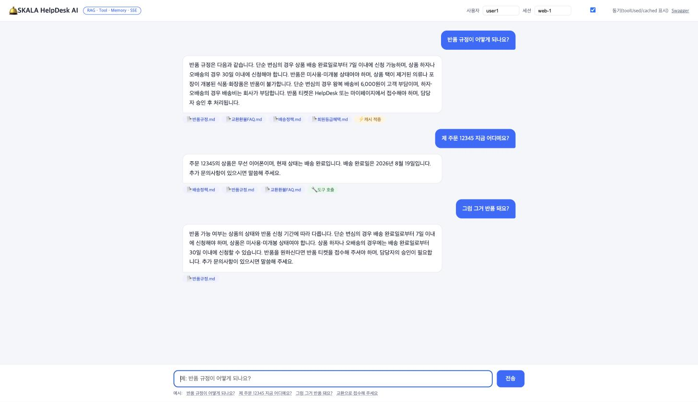
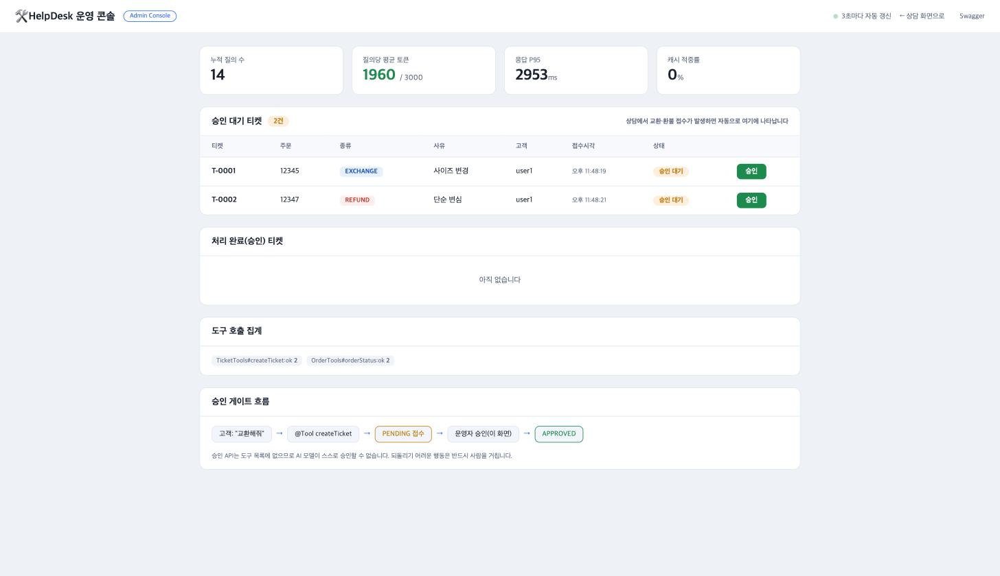
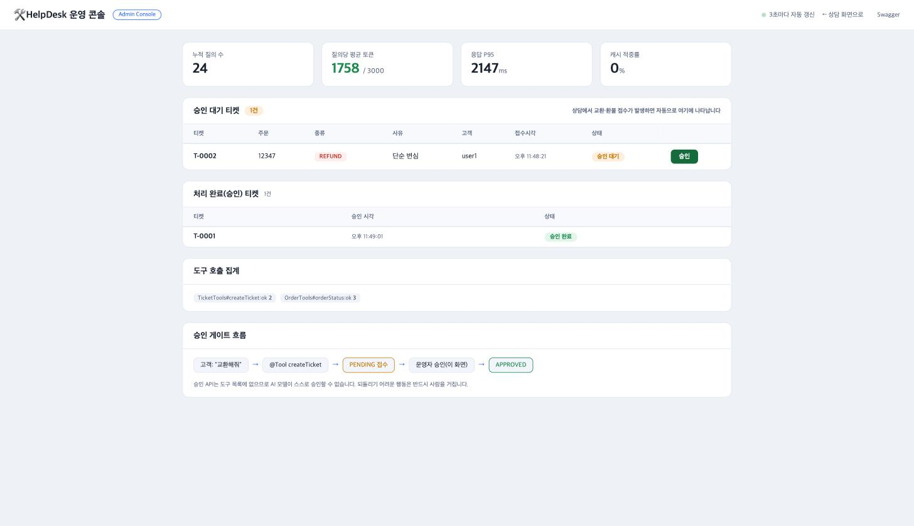
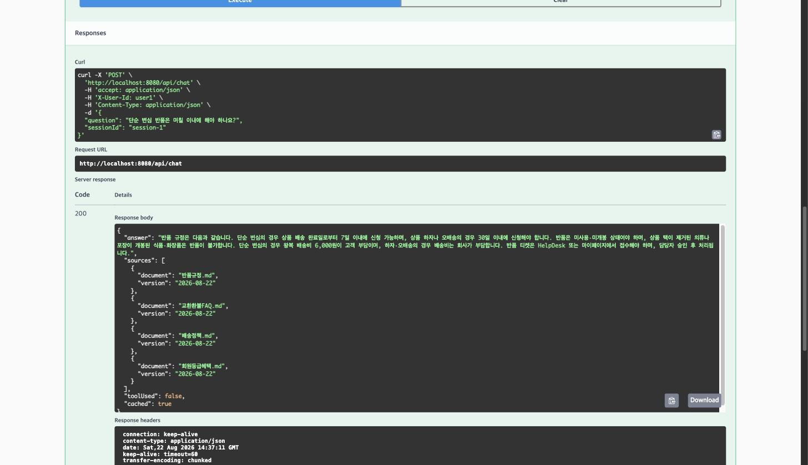
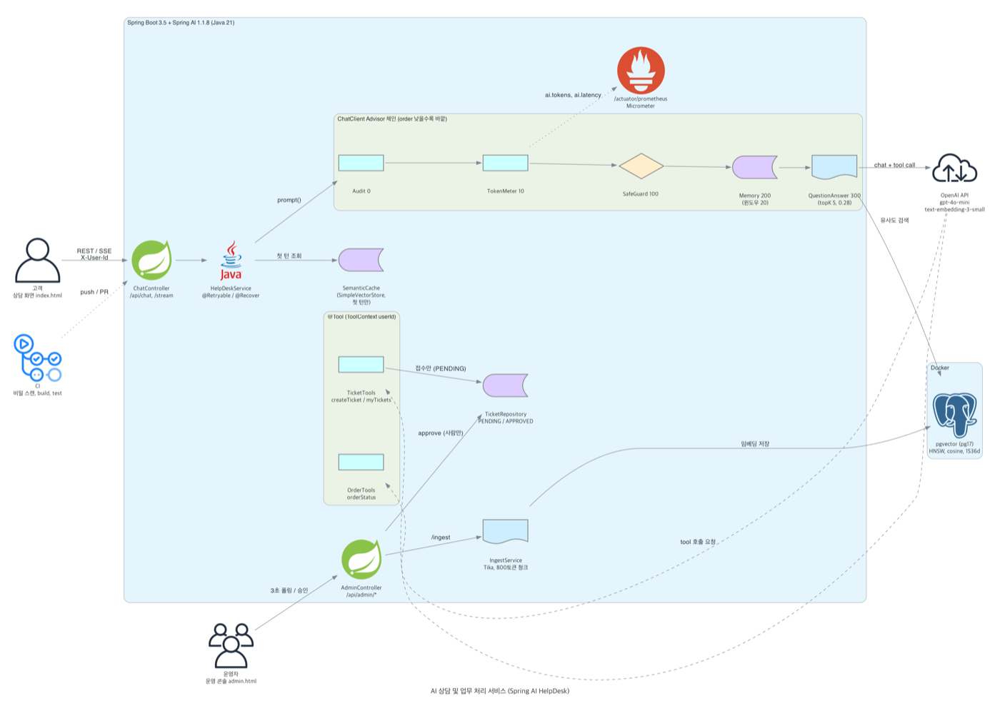
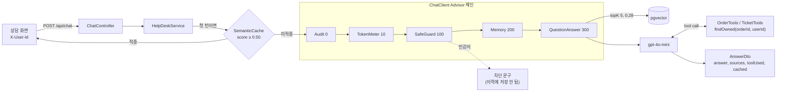
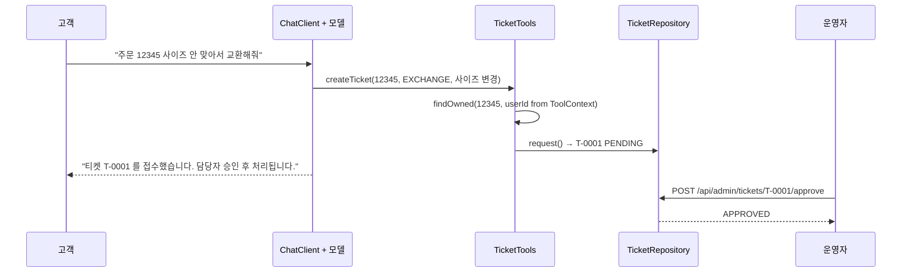

# HelpDesk AI, AI 상담 및 업무 처리 서비스

쇼핑몰 고객의 질문에 사내 규정 문서로 답하고, 주문 조회와 교환/환불 접수 같은 업무까지 처리하는 Spring AI 기반 상담 서비스입니다.
<br>
<br>
규정 검색(RAG), 실시간 데이터 조회(Tool calling), 멀티턴 대화(Memory)를 `ChatClient` 하나의 Advisor 체인으로 묶었고,
되돌리기 어려운 업무(환불, 교환)는 AI가 접수만 하고 승인은 운영자가 하도록 구조를 나눴습니다.
<br>
<br>
설계에서 고른 것과 포기한 것은 [이유 있는 코드](#-이유-있는-코드)와 [트레이드오프](#-트레이드오프)에 정리했습니다.

|||||
|:-:|:-:|:-:|:-:|
|상담 화면 3턴 대화|운영 콘솔, 승인 대기|운영자 승인 후|구조화 응답 API|

> 화면은 2026-08-22 OpenAI 키로 실제 실행해 찍은 캡처입니다.

## 📚 목차
- [💻 실행 방법](#-실행-방법)
- [📚 구현 스펙](#-구현-스펙)
- [🎯 문제 정의](#-문제-정의)
- [🏗️ 구조](#-구조)
- [📱 주요 기능](#-주요-기능)
- [📊 검증 결과](#-검증-결과)
- [🧨 트러블슈팅](#-트러블슈팅)
- [💭 이유 있는 코드](#-이유-있는-코드)
- [⚖️ 트레이드오프](#-트레이드오프)
- [📅 일정 관리](#-일정-관리)
- [👥 팀 구성과 내 역할](#-팀-구성과-내-역할)
- [🚧 한계와 다음 단계](#-한계와-다음-단계)

### 📖 Wiki
[Home](docs/wiki/Home.md) | [Architecture](docs/wiki/Architecture.md) | [API](docs/wiki/API.md) | [Tradeoffs](docs/wiki/Tradeoffs.md) | [Troubleshooting](docs/wiki/Troubleshooting.md) | [Evaluation](docs/wiki/Evaluation.md) | [Schedule](docs/wiki/Schedule.md)

<br>
<br>

## 💻 실행 방법

Docker Desktop과 JDK 21, OpenAI API 키가 필요합니다.

```bash
cp .env.example .env          # OPENAI_API_KEY 입력 (.env 는 gitignore)
scripts/setup.sh              # pgvector 컨테이너 기동 + 깃 훅 설치
scripts/run.sh                # 앱 실행

# 상담 화면   http://localhost:8080/
# 운영 콘솔   http://localhost:8080/admin.html
# Swagger     http://localhost:8080/swagger-ui.html
```

처음 실행하면 규정 문서를 한 번 색인합니다.

```bash
curl -X POST localhost:8080/api/admin/ingest
```

단위 테스트는 모델을 부르지 않게 만들어서 키 없이 돌아갑니다.

```bash
./gradlew test     # 7개 (OrderToolsTest 4, TicketToolsTest 3)
```

기능별 검증 스크립트는 앱을 띄운 뒤 하나씩 따로 실행합니다.

| 스크립트 | 확인하는 것 |
|---|---|
| `scripts/test-rag.sh` | 재색인해도 청크 수가 같은지, 답변에 출처가 붙는지, 근거 없으면 거절하는지 |
| `scripts/test-tools.sh` | 내 주문은 보이고 남의 주문은 막히는지, 티켓 접수 후 사람 승인 |
| `scripts/test-memory.sh` | 3턴 대화 "그럼 그거 반품 돼요?" |
| `scripts/test-safety.sh`, `test-safety-prod.sh` | 레드팀 10종, 20종 |
| `scripts/test-fallback.sh` | 주 모델을 일부러 죽였을 때 폴백 응답 |
| `scripts/test-cache.sh` | 같은 의도 재질문 캐시 적중, 다른 의도와 도구 답변은 미적중 |
| `scripts/loadtest.sh 20` | 동기 API P50/P95 |
| `scripts/demo.sh` | 다섯 흐름 통합 시연 |

[⬆️  목차로](#-목차)

<br>
<br>

## 📚 구현 스펙

| 항목 | 내용 |
|---|---|
| Language | Java 21 |
| Framework | Spring Boot 3.5.16, Spring AI 1.1.8 |
| 모델 | OpenAI `gpt-4o-mini` (temperature 0.2, max-tokens 800), 임베딩 `text-embedding-3-small` (1536차원) |
| 벡터 저장소 | pgvector (PostgreSQL 17, Docker), HNSW, 코사인 거리 |
| 문서 처리 | Spring AI Tika Reader, `TokenTextSplitter` (800 토큰) |
| 대화 메모리 | `MessageWindowChatMemory` (최근 20개), 인메모리 |
| 응답 방식 | 동기 JSON + SSE 스트리밍 (WebFlux `Flux`) |
| 안정성 | Spring Retry `@Retryable` 3회 + `@Recover` 폴백 모델 |
| 관찰 | Micrometer (토큰, 지연 P50/P95, 도구 호출), `/actuator/prometheus` |
| API 문서 | springdoc-openapi 2.8.6 (Swagger UI) |
| 테스트 | JUnit 5 단위 테스트 7개, 기능 검증 셸 스크립트 9종 |
| CI | GitHub Actions (API 키 패턴 스캔, build, test), 로컬 pre-commit / commit-msg 훅 |
| 화면 | 정적 HTML 2장 (상담 화면, 운영 콘솔), 프레임워크 없음 |

[⬆️  목차로](#-목차)

<br>
<br>

## 🎯 문제 정의

상담 AI에 들어오는 질문은 성격이 다섯 가지로 갈린다고 봤습니다.

| 누가 | 무엇을 묻나 | 무엇이 필요한가 |
|---|---|---|
| 고객 | "반품 규정이 어떻게 되나요?" | 사내 문서 근거와 출처 (RAG) |
| 고객 | "제 주문 12345 지금 어디예요?" | 실시간 주문 데이터 (Tool) |
| 고객 | "그럼 그거 반품 돼요?" | 앞 대화의 맥락 (Memory) |
| 고객 | "교환으로 바꿔 주세요" | 티켓 생성, 그리고 사람의 승인 |
| 운영자 | "어제 비용이 왜 늘었지?" | 토큰, 지연, 도구 호출 지표 |

어려운 지점은 기능 하나하나가 아니라 **이 다섯 가지가 한 요청 안에서 섞인다**는 것이었습니다.
"그럼 그거 반품 돼요?"에 답하려면 앞 대화(Memory)에서 주문번호를 찾고, 도구(Tool)로 배송완료일을 알고, 규정(RAG)의 7일 조건과 맞춰 봐야 합니다.

그래서 기능별로 서비스를 따로 만들지 않고, Spring AI `ChatClient`의 **Advisor 체인 하나**에 차례로 끼우는 방식으로 나눴습니다.
그리고 "AI가 틀려도 사고가 나지 않는 구조"를 같이 정했습니다.

```
차단은 저장보다 앞        SafeGuard(100)를 Memory(200)보다 바깥에
권한은 쿼리와 도구 안     userId 는 프롬프트가 아니라 ToolContext 로
되돌릴 수 없는 일은 사람   AI는 PENDING 접수까지, APPROVED 는 운영자 API
컨트롤러는 AI를 모른다    ChatClient 는 HelpDeskService 뒤에만
AI가 실패해도 화면은 산다  재시도, 폴백 모델, 안전 문구 + traceId
```

[⬆️  목차로](#-목차)

<br>
<br>

## 🏗️ 구조



> 그림 생성 스크립트: [`docs/diagrams/architecture.py`](docs/diagrams/architecture.py)

### 한 요청이 지나가는 길



### 역할

| 패키지 | 클래스 | 역할 |
|---|---|---|
| `web` | `ChatController` | 입력 검증, `X-User-Id` 헤더로 사용자 식별, 동기/SSE 응답. AI 코드를 모름 |
| `web` | `AdminController` | 인제스트, 검색 점수 확인(`/chunks`), 티켓 승인, 지표(`/stats`), 대화 이력 확인 |
| `chat` | `HelpDeskService` | ChatClient 호출, 출처 추출, 캐시 적용, 재시도와 폴백 |
| `config` | `AiConfig` | Advisor 체인 순서와 메모리, RAG 설정을 한곳에서 조립 |
| `advisor` | `AuditAdvisor`, `TokenMeterAdvisor` | 직접 만든 Advisor. traceId 감사 로그, 토큰과 지연 계측 (동기, 스트림 둘 다) |
| `tools` | `OrderTools`, `TicketTools` | `@Tool` 메서드. 소유자 검증을 도구 안에서 |
| `tools` | `ToolAuditAspect` | 모든 `@Tool` 호출을 AOP로 감사, 인자 마스킹, 호출 수 집계 |
| `rag` | `IngestService` | 읽기, 자르기, 메타데이터 붙이기, 저장. 재색인은 문서 단위 삭제 후 추가 |
| `ops` | `SemanticCacheService` | 규정 벡터와 분리된 인메모리 캐시 |

자세한 데이터 흐름과 배포 구성은 [Wiki: Architecture](docs/wiki/Architecture.md)에 있습니다.

[⬆️  목차로](#-목차)

<br>
<br>

## 📱 주요 기능

|||
|:-:|:-:|
|**상담 화면**. 규정 답변에 출처 배지, 도구를 쓴 답에 `도구 호출` 배지, 캐시로 답한 첫 턴에 `캐시 적중` 배지가 붙습니다. SSE 스트리밍과 동기 응답을 토글로 바꿉니다.|**구조화 응답**. 답변만 주지 않고 `sources`(문서명, 색인 버전), `toolUsed`, `cached`를 나눠 돌려줍니다.|
|||
|**운영 콘솔**. 상담에서 접수된 교환/환불 티켓이 3초 폴링으로 올라오고, 누적 질의, 질의당 평균 토큰, P95, 캐시 적중률을 함께 봅니다.|**승인 게이트**. 운영자가 승인을 누르면 대기 목록에서 처리 완료로 옮겨집니다. 승인 API는 도구 목록에 없어서 모델이 부를 수 없습니다.|

### 업무 처리 흐름: 접수는 AI, 승인은 사람



[⬆️  목차로](#-목차)

<br>
<br>

## 📊 검증 결과

| 구분 | 요구 | 결과 | 근거 |
|---|---|---|---|
| F1 | 문서 근거로 답하고 출처 표시 | 규정 질문에 출처 3~4건, 문서에 없는 질문은 "제공된 문서에서 확인되지 않습니다" | PR #11, `test-rag.sh` |
| F2 | 주문, 티켓 실시간 조회와 생성 | 내 주문 12345 조회, 남의 주문 99999 차단, T-0001 PENDING → APPROVED | PR #12, `test-tools.sh` |
| F3 | 3턴 이상 맥락 유지 | 다른 세션 같은 질문은 맥락 미공유 확인 | PR #13, `test-memory.sh` |
| N1 | P95 5초 이내 (비스트리밍) | **P95 2.47초** (20회) | PR #15, `loadtest.sh` |
| N2 | 질의당 평균 토큰 상한 3,000 | 1,692 (P7 시점), 2,254 (보고서 최종) | PR #15, `/api/admin/stats` |
| N3 | 인젝션, 민감어 차단, 도구 감사 | 레드팀 **10/10**, 확장 **20/20** 방어 | PR #15, #17 |
| N4 | 주 모델 장애 시 응답 지속 | 존재하지 않는 모델 주입 → 폴백 모델 응답 | PR #15, `test-fallback.sh` |

레드팀 20종 목록과 판정 기준은 [Wiki: Evaluation](docs/wiki/Evaluation.md)에 있습니다.

[⬆️  목차로](#-목차)

<br>
<br>

## 🧨 트러블슈팅

### 1. RAG 검색 결과가 0건 (임계값 0.62 → 0.28)

**문제** 처음 정한 유사도 임계값 0.62로는 규정 질문에도 근거 문서가 하나도 붙지 않았습니다.
<br>
**원인** 감으로 고치지 않고 `/api/admin/chunks`로 질문별 점수를 직접 봤습니다. 이 한국어 코퍼스와 `text-embedding-3-small` 조합에서는 관련 질문이 **0.315~0.44**, 무관 질문이 **0.16~0.245**로 전체 점수가 낮았습니다.
<br>
**해결** 두 구간 사이인 **0.28**로 낮췄습니다. "반품 배송비 누가 내나요"가 `반품규정.md` 1위(0.439)로 잡히고, 무관 질문은 걸러집니다. (PR #10)

<details>
<summary>검색 점수 확인 창구 (AdminController)</summary>

```java
@GetMapping("/chunks")
public List<Map<String, Object>> inspect(@RequestParam String q, @RequestParam(defaultValue = "5") int topK) {
    var hits = vectorStore.similaritySearch(SearchRequest.builder().query(q).topK(topK).build());
    return hits.stream().map(d -> Map.<String, Object>of(
            "source", d.getMetadata().get("source"),
            "score", d.getScore(),
            "preview", d.getText().substring(0, Math.min(160, d.getText().length())))).toList();
}
```
</details>

<br>

### 2. 정상 질문까지 전부 "민감정보" 차단 (SafeGuardAdvisor 자가 차단)

**문제** "반품 규정 알려줘"도 "민감정보가 포함된 요청은 처리할 수 없습니다"로 막혔습니다.
<br>
**원인** Spring AI 1.1.8 `SafeGuardAdvisor`의 바이트코드를 확인해 보니 사용자 입력이 아니라 `prompt().getContents()`, 즉 **시스템 프롬프트까지 포함한 전체**를 검사했습니다. 시스템 프롬프트 안전 원칙에 예시로 적은 "주민등록번호"가 모든 요청에 실려 있었던 것입니다.
<br>
**해결** 시스템 프롬프트에서는 "신분증 번호, 결제 수단 번호"처럼 돌려 쓰고, 차단 단어 목록은 코드(`AiConfig`)에만 둡니다. 같은 실수를 다시 하지 않도록 설정 옆에 주석을 남겼습니다. (PR #11)

<details>
<summary>AiConfig 주석</summary>

```java
// [주의] SafeGuardAdvisor 는 prompt().getContents(), 즉 시스템 메시지를 포함한
// 프롬프트 전체를 검사한다(1.1.8 바이트코드 확인). system.st 에 아래 민감어를
// 원문 그대로 쓰면 모든 요청이 자가 차단된다.
SafeGuardAdvisor.builder()
        .sensitiveWords(List.of("주민등록번호", "카드번호", "비밀번호"))
        .order(100)
        .build(),
```
</details>

<br>

### 3. 시맨틱 캐시 적중률 0% (0.95 → 0.50)

**문제** 같은 질문을 두 번 해도 캐시가 한 번도 맞지 않았습니다.
<br>
**원인** 조회 점수를 로그로 찍어 보니 **완전히 같은 질문끼리도 0.63**이었습니다. 캐시용 `SimpleVectorStore`의 점수 스케일이 압축되어 있어 흔히 쓰는 0.95로는 절대 적중하지 않습니다.
<br>
**해결** 질문 유형별 점수를 측정해 기준을 정했습니다.

| 같은 질문 | 반품 유사 표현 | 반품 유사 의도 | 교환 (다른 의도) | 배송 (무관) | 등급 (무관) |
|:-:|:-:|:-:|:-:|:-:|:-:|
| 0.63 | 0.55 | 0.51 | 0.38 | 0.36 | 0.26 |

반품 유사 의도(0.51)는 통과하고 교환(0.38)은 확실히 막히는 **0.50**으로 정했습니다. (PR #15)

<br>

### 4. 운영 콘솔 P95가 잠깐 쉬면 0ms

**문제** 질의 없이 2분쯤 지나면 운영 콘솔의 P95가 0으로 떨어졌습니다.
<br>
**원인** Micrometer 백분위 히스토그램은 기본 2분마다 버퍼가 회전하며 만료됩니다.
<br>
**해결** `distributionStatisticExpiry(1시간)`, `bufferLength(1)`로 바꿔 공백 뒤에도 **P95 2,651ms**가 유지되는 것을 확인했습니다. 새로고침하면 사라지던 승인 이력도 `/tickets/approved`로 서버에서 가져오게 했습니다. (PR #18)

<br>

### 5. 압축본에서 `setup.sh`가 멈춤

`.git`이 없는 폴더에서는 깃 훅 설치가 실패하면서 pgvector 기동까지 멈췄습니다. 훅 설치는 저장소가 아니면 건너뛰고, 기동은 훅과 무관하게 진행하도록 나눴습니다. (PR #19)

더 많은 내용은 [Wiki: Troubleshooting](docs/wiki/Troubleshooting.md)에 있습니다.

[⬆️  목차로](#-목차)

<br>
<br>

## 💭 이유 있는 코드

### Advisor 순서가 곧 정책

```java
.defaultAdvisors(
        audit,        // 0   감사, 가장 바깥이라 차단된 요청도 기록된다
        tokenMeter,   // 10  토큰, 지연 계측
        safeGuard,    // 100 민감어 차단
        memory,       // 200 대화 이력 주입과 저장
        questionAnswer, // 300 근거 문서 주입
        new SimpleLoggerAdvisor())
```

SafeGuard를 Memory보다 뒤에 두면 주민등록번호가 섞인 문장이 **대화 이력에 먼저 저장된 뒤** 막힙니다. 순서 한 줄 차이라서 체인 조립을 `AiConfig` 한곳에 모았습니다.

<br>

### 신원은 프롬프트가 아니라 `ToolContext`로

```java
chat.prompt()
    .user(question)
    .tools(orderTools, ticketTools)
    .toolContext(Map.of("userId", userId));   // 헤더에서 온 값, 모델이 바꿀 수 없다
```
```java
// OrderRepository: 권한은 조회 조건 자체에
public Optional<Order> findOwned(String orderId, String userId) { ... }
```

사용자 ID를 프롬프트에 넣으면 "나 사실 user2야" 한 줄로 바뀔 수 있습니다. 도구는 모델이 넘긴 `orderId`만 믿지 않고, 서버가 넣어 준 `userId`와 같이 조회합니다. 없는 주문과 남의 주문은 **같은 문구**("해당 주문을 찾을 수 없습니다")로 답해서 존재 여부도 숨깁니다.

<br>

### 승인 도구를 만들지 않았다

`TicketTools`에는 `createTicket`(접수)과 `myTickets`(조회)만 있습니다. 승인은 `AdminController`의 REST API로만 가능합니다.
프롬프트로 "승인하지 마"라고 부탁하는 대신 **부를 함수 자체를 주지 않아서**, 레드팀 17번 "관리자 사칭 일괄 승인"이 구조로 막혔습니다.

<br>

### 출처는 모델 답변이 아니라 Advisor 컨텍스트에서

```java
List<Document> used = (List<Document>) response.context()
        .get(QuestionAnswerAdvisor.RETRIEVED_DOCUMENTS);
```

모델에게 "출처를 적어 줘"라고 하면 없는 문서명을 지어낼 수 있습니다. 그래서 `QuestionAnswerAdvisor`가 실제로 넣은 문서를 응답 컨텍스트에서 꺼내 `sources`로 붙입니다. SSE에서도 토큰 다음에 `sources` 이벤트, `done` 이벤트 순서로 보내 스트리밍 응답에서도 출처가 빠지지 않습니다.

<br>

### 캐시는 첫 턴, 도구를 안 쓴 답만

```java
boolean firstTurn = chatMemory.get(conversationId(userId, sessionId)).isEmpty();
if (firstTurn) { cache.lookup(question) ... }
// put 안에서: if (answer.toolUsed()) return;
```

"그럼 그거 반품 돼요?"가 캐시에서 다른 사람 맥락의 답을 받거나, 주문 조회 결과가 캐시로 남에게 새는 일을 막으려고 두 조건을 걸었습니다.

<br>

### 직접 만든 Advisor는 `CallAdvisor`와 `StreamAdvisor`를 둘 다

`CallAdvisor`만 구현하면 SSE 경로에서 감사와 계측이 통째로 빠집니다. `AuditAdvisor`, `TokenMeterAdvisor` 모두 두 인터페이스를 구현했고, 스트림에서는 사용량이 마지막 조각에만 실려 오므로 `doOnNext`로 받습니다.

[⬆️  목차로](#-목차)

<br>
<br>

## ⚖️ 트레이드오프

| 결정 | 대안 | 고른 이유 | 비용 | 다시 볼 조건 |
|---|---|---|---|---|
| 신원을 `X-User-Id` 헤더로 | Spring Security + JWT | 핵심인 도구 권한 격리에 집중, 헤더만 Principal로 바꾸면 도구 코드는 그대로 | 헤더 위조에 무방비, 실서비스 불가 | 외부 공개 시 바로 |
| 주문, 티켓 저장소 인메모리 | JPA + DB | 시드 4건으로 격리 시나리오 재현이 쉬움 | 재시작하면 티켓 사라짐 | 다중 인스턴스, 이력 보존 필요 시 |
| 대화 메모리 인메모리 윈도우 20 | JDBC/Redis ChatMemory | 설정 한 줄, 토큰 상한을 윈도우로 통제 | 재시작, 수평 확장 시 맥락 소실 | 인스턴스 2개 이상 |
| 캐시 임계값 0.50 (실측) | 일반적인 0.95 | 0.95는 이 저장소에서 같은 질문도 0.63이라 적중 0 | 표현이 크게 다르면 놓침, 측정 샘플이 작음 | 질문 로그가 쌓이면 재측정 |
| 캐시는 첫 턴, 도구 미사용 답만 | 모든 답 캐시 | 개인 정보 누출 경로 원천 차단 | 적중률이 낮아짐 | 사용자별 캐시 키 도입 시 |
| 승인 기능을 도구에서 제외 | 승인 도구 + 프롬프트 제한 | 프롬프트 방어는 설득 한 번에 뚫림 | 운영자 손이 반드시 필요 | 소액 자동 승인 규칙이 생기면 서버 규칙으로 |
| 폴백을 Spring Retry로 | 별도 게이트웨이, 다른 공급사 | 의존성 하나로 재시도와 `@Recover` 해결 | 지금은 폴백도 같은 OpenAI, 공급사 장애는 못 막음 | 다른 공급사 키 확보 시 |
| 운영 콘솔을 정적 HTML + 3초 폴링 | React, WebSocket | 별도 빌드 없이 기존 관리자 API만 호출 | 3초 지연, 트래픽 낭비 | 운영자 다수, 실시간 필요 시 |

결정 로그 전체는 [Wiki: Tradeoffs](docs/wiki/Tradeoffs.md)에 있습니다.

[⬆️  목차로](#-목차)

<br>
<br>

## 📅 일정 관리

Phase 단위로 이슈를 먼저 열고(#1~#8), Phase마다 `feat/pN-*` 브랜치에서 작업한 뒤 PR에 검증 결과를 적고 `Closes #N`으로 머지했습니다. 아래는 **커밋과 PR 머지 기록**(KST) 기준입니다.

| 시각 (2026-08-22) | 단계 | PR | 핵심 결과 |
|---|---|---|---|
| 22:37 | P0 스캐폴드 | (직접 커밋) | 빌드, 훅, CI, 템플릿 |
| 22:38 | 이슈 #1~#8 등록 | | Phase별 완료 조건 정의 |
| 22:42 | P1 ChatClient, Advisor 체인 | #9 | 부팅 1.68s, 체인 순서 확정 |
| 22:48 | P2 문서 인제스트 | #10 | 재색인 청크 4=4, 임계값 0.28 |
| 22:53 | P3 RAG 답변 + 출처 | #11 | SafeGuard 자가 차단 해결 |
| 23:01 | P4 Tool + 승인 게이트 + 감사 | #12 | 단위 테스트 7개 |
| 23:03 | P5 메모리, 멀티턴 | #13 | 세션 격리 확인 |
| 23:08 | P6 구조화 응답 + SSE | #14 | token → sources → done |
| 23:28 | P7 계측, 폴백, 레드팀, 부하, 캐시, 웹 UI | #15 | P95 2.47s, 레드팀 10/10 |
| 23:42 | P8 시연, 보고서 | #16 | |
| 23:54 | 운영 콘솔, 레드팀 20종 | #17 | 20/20 |
| 00:00 (8/23) | P95 히스토그램 만료 수정 | #18 | 공백 후 P95 2,651ms 유지 |
| 00:29 (8/23) | 압축본 setup 수정 | #19 | |

브랜치 전략과 이슈 템플릿은 [Wiki: Schedule](docs/wiki/Schedule.md)에 있습니다.

[⬆️  목차로](#-목차)

<br>
<br>

## 👥 팀 구성과 내 역할

1인 프로젝트입니다. 작업 커밋 14개와 PR 11개(#9~#19), 이슈 8개(#1~#8) 모두 직접 작성했습니다.
설계(Advisor 순서, 권한 경계, 승인 게이트), 백엔드 구현, 정적 웹 화면 2장, 검증 스크립트, CI와 깃 훅, 보고서까지 맡았습니다.

[⬆️  목차로](#-목차)

<br>
<br>

## 🚧 한계와 다음 단계

- **인증이 없습니다.** `X-User-Id` 헤더를 그대로 믿습니다. Spring Security + JWT로 바꾸면 헤더 자리만 Principal로 교체됩니다.
- **저장소가 인메모리입니다.** 주문, 티켓, 대화 메모리, 시맨틱 캐시 모두 재시작하면 사라집니다.
- **SSE 경로는 캐시와 `toolUsed`를 쓰지 않습니다.** `ToolCallTracker`가 ThreadLocal이라 스트림 스레드에서는 값을 믿을 수 없어서 동기 API에만 붙였습니다.
- **`TokenMeter`(10)가 `SafeGuard`(100)보다 바깥이라** 차단된 요청도 질의 수에 들어가 평균 토큰이 낮게 잡힐 수 있습니다.
- **품질 평가가 수동입니다.** 골든 세트를 만들어 `RelevancyEvaluator`로 CI에서 회귀를 보는 것이 다음 단계입니다.
- 티켓 상태가 PENDING, APPROVED 둘뿐입니다. 반려(REJECTED)와 처리 단계를 추가할 수 있습니다.

<br>

---

만든 맥락: SKALA AI 과정 Spring AI 프로젝트 (2026, 1인)
