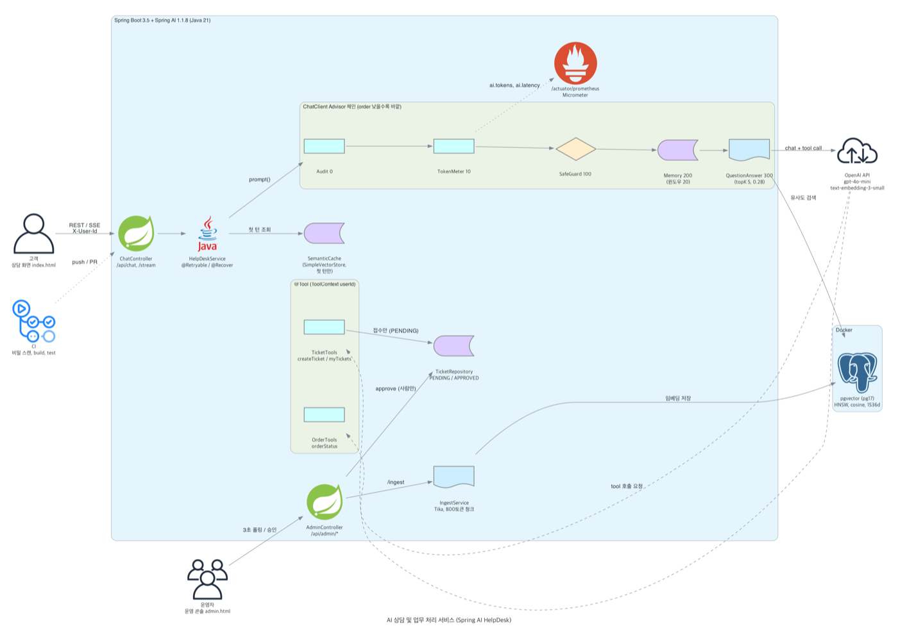
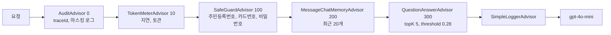
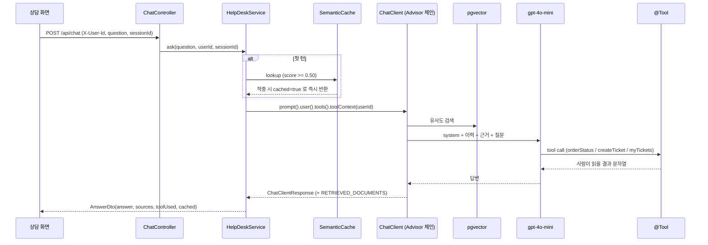
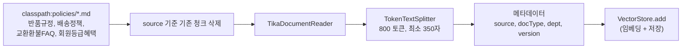

# Architecture

그림은 [`docs/diagrams/architecture.py`](../diagrams/architecture.py)로 다시 만들 수 있습니다 (Python `diagrams` + graphviz).

## 구성 요소

| 구성 요소 | 기술 | 하는 일 |
|---|---|---|
| 상담 화면 | `static/index.html` | 동기 `/api/chat` 또는 SSE `/api/chat/stream` 호출, 출처/도구/캐시 배지 |
| 운영 콘솔 | `static/admin.html` | 3초마다 `/tickets/pending`, `/tickets/approved`, `/stats` 폴링, 승인 버튼 |
| API 서버 | Spring Boot 3.5.16 (MVC + WebFlux) | 상담, 운영자 API, Swagger, Actuator |
| AI 오케스트레이션 | Spring AI 1.1.8 `ChatClient` | Advisor 체인, Tool calling, 스트리밍 |
| 벡터 저장소 | pgvector `pgvector/pgvector:pg17` (Docker) | 규정 청크 임베딩, HNSW, 코사인, 1536차원 |
| 모델 | OpenAI `gpt-4o-mini`, `text-embedding-3-small` | 답변 생성, 임베딩 |
| 시맨틱 캐시 | Spring AI `SimpleVectorStore` (인메모리) | 규정 벡터와 분리된 질문-답 캐시 |
| 관찰 | Micrometer, `/actuator/prometheus` | `ai.latency`, `ai.tokens`, `ai.queries`, `ai.tool.calls` |
| CI | GitHub Actions | API 키 패턴 스캔, `./gradlew build` |

## Advisor 체인

order가 낮을수록 바깥입니다. 요청은 위에서 아래로, 응답은 역순으로 지나갑니다.

| 위치 | 이유 |
|---|---|
| Audit 가장 바깥 | 차단, 검색, 도구, 모델 무엇이 일어나도 감사 로그에 남게 |
| SafeGuard가 Memory 앞 | 민감어가 섞인 문장이 대화 이력에 저장되기 전에 막기 위해 |
| QA가 가장 안쪽 | 메모리로 맥락이 붙은 질문에 근거 문서를 붙이기 위해 |

직접 만든 `AuditAdvisor`, `TokenMeterAdvisor`는 `CallAdvisor`와 `StreamAdvisor`를 모두 구현해 SSE 경로에서도 빠지지 않습니다.

## 동기 요청 흐름

실패하면 `@Retryable`이 `TransientAiException`, `IOException`에 한해 1s, 2s, 4s 간격으로 최대 3회 시도하고, 그래도 안 되면 `@Recover`가 호출 단위 `ChatOptions`로 폴백 모델을 부릅니다. 폴백도 실패하면 "지금은 답변을 드리기 어렵습니다" 문구를 돌려줍니다.

## SSE 흐름

`POST /api/chat/stream`은 `token` 이벤트를 흘려보낸 뒤 `sources`(JSON), `done`(`[DONE]`) 순서로 끝납니다. 출처는 스트림 도중 응답 컨텍스트에서 잡아 두었다가 마지막에 보냅니다. 끊긴 클라이언트가 비용이 되지 않도록 60초 타임아웃을 겁니다.

## RAG 인제스트

재색인을 두 번 해도 청크 수가 같아야 정상입니다 (실측 4=4). 메타데이터는 인제스트 시점에만 넣을 수 있어서 출처 표기에 쓸 `source`, `version`을 이 단계에서 붙입니다.

## 업무 처리 (Tool calling)

| 도구 | 설명 | 보호 장치 |
|---|---|---|
| `OrderTools.orderStatus(orderId)` | 배송 상태, 도착(예정)일 | `findOwned(orderId, userId)`, 없는 주문과 남의 주문을 같은 문구로 |
| `TicketTools.createTicket(orderId, type, reason)` | 교환/환불 티켓 접수 | 소유자 검증 후 PENDING 으로만 생성 |
| `TicketTools.myTickets()` | 내 티켓 목록과 상태 | userId 필터 |
| (도구 아님) `POST /api/admin/tickets/{no}/approve` | 승인 | 운영자 전용, 모델이 부를 수 없음 |

모든 `@Tool` 호출은 `ToolAuditAspect`가 `AI_TOOL_AUDIT` 로거에 남기고, 주민등록번호, 카드번호, 이메일 형태의 인자는 마스킹합니다. 같은 Aspect가 `ToolCallTracker`에 사용 여부를 기록해 `AnswerDto.toolUsed`의 근거가 됩니다.

## 대화 메모리

대화 ID는 `HelpDeskService.conversationId()` 한곳에서 `skala:{userId}:{sessionId}` 형태로 만듭니다. 사용자와 세션이 다르면 이력이 섞이지 않고, `/api/admin/history`로 실제 저장된 이력을 볼 수 있습니다.

## 실행 환경

| 항목 | 값 |
|---|---|
| 앱 | `scripts/run.sh` (.env 로드 후 `bootRun`), 포트 8080 |
| DB | `docker-compose.yml`의 `helpdesk-pgvector`, 포트 5432, 볼륨 `helpdesk-pgdata` |
| 장애 주입 | `SPRING_PROFILES_ACTIVE=failover` (존재하지 않는 모델 `gpt-none-exist-chaos`) |
| 설정 | 모델, 임계값, 윈도우 크기, 토큰 예산은 `application.yml`의 `helpdesk.*`로 분리 |

배포 환경(클라우드)은 구성하지 않았고 로컬 Docker + 앱 실행 기준입니다.

[Home](Home.md)
