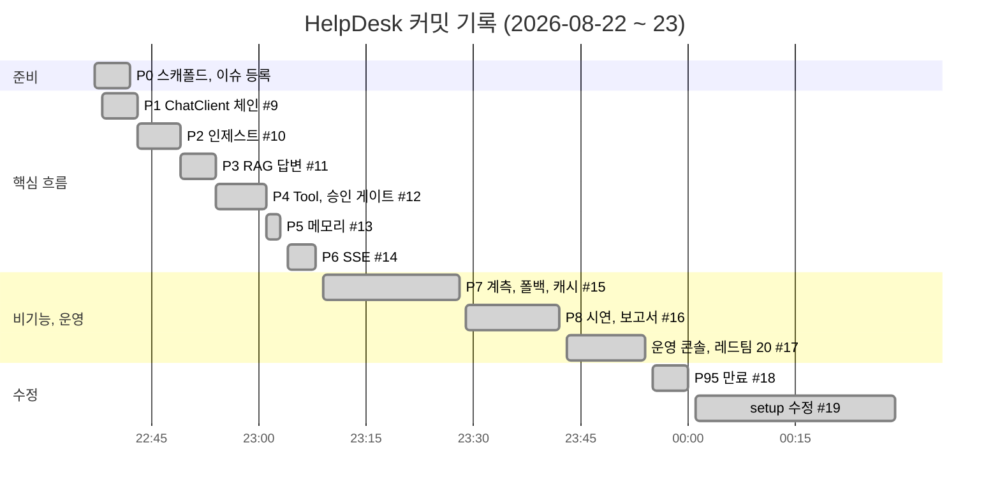

# Schedule

## 일하는 방식

1. 기능을 Phase(P1~P8)로 나누고 **구현 전에 이슈 8개를 한 번에 등록** (`.github/ISSUE_TEMPLATE/phase.md`: 목표, 작업 항목, 완료 판정)
2. Phase마다 `feat/pN-이름` 브랜치
3. PR 본문은 템플릿(`무엇을 / 왜 / 어떻게 검증했나 / 체크리스트`)으로, 검증 숫자를 근거로 남김
4. `Closes #N`으로 이슈를 닫으며 main에 머지 (merge commit)
5. 이후 버그는 `fix/*` 브랜치

커밋 메시지는 `feat|fix|test|docs|chore|refactor|ci|style: 요약` 규칙을 `commit-msg` 훅으로 강제했습니다.

## 타임라인 (커밋, PR 머지 시각 KST)

간트 막대는 앞 PR 머지부터 다음 PR 머지까지의 간격입니다. 저장소에 올린 시점 기준이며, 그 전에 로컬에서 진행한 작업 시간은 포함되지 않습니다.

| 이슈 | 제목 | 닫은 PR |
|---|---|---|
| #1 | [P1] ChatClient, Advisor 체인 조립 | #9 |
| #2 | [P2] 문서 인제스트 파이프라인 | #10 |
| #3 | [P3] RAG 답변 + 출처 표기 | #11 |
| #4 | [P4] Tool 연동, 주문/티켓 + 승인 게이트 + 감사 | #12 |
| #5 | [P5] 메모리와 멀티턴 | #13 |
| #6 | [P6] 구조화 응답 API + SSE | #14 |
| #7 | [P7] 계측, 폴백, 레드팀, 부하, 테스트, UI, 캐시 | #15 |
| #8 | [P8] 검증 다섯 흐름 + 제출물 | #16 |

이후 #17(운영 콘솔, 레드팀 20종), #18(P95 히스토그램), #19(setup 스크립트)는 이슈 없이 PR로 진행했습니다.

## 쪼갠 기준

- **의존 순서**: 체인(P1) → 근거 저장(P2) → 근거 사용(P3) → 행동(P4) → 맥락(P5) → 응답 형식(P6). 앞 단계가 없으면 다음 단계를 검증할 수 없는 순서입니다.
- **검증 가능한 단위**: Phase마다 `scripts/test-*.sh` 하나가 대응하도록 나눴습니다.
- **비기능은 마지막에 묶음**: 계측, 폴백, 캐시는 기능이 다 붙은 뒤에야 의미 있는 숫자가 나와서 P7로 모았습니다.

[Home](Home.md)
